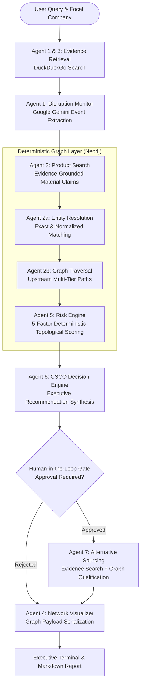

# Supply Chain Disruption Monitor (SCDM)

[](https://www.python.org/downloads/)
[](https://neo4j.com/)
[](https://github.com/langchain-ai/langgraph)
[](https://ai.google.dev/)
[](LICENSE)

An enterprise-grade, deterministic-hybrid multi-agent framework designed to detect real-world supply chain disruptions, quantify multi-tier exposure across canonical knowledge graphs, and formulate verified mitigation and alternative sourcing strategies.

---

## 📌 Executive Summary & Core Dilemma

Modern supply chain risk management faces a critical architectural trade-off:
* **Large Language Models (LLMs)** excel at digesting unstructured external news, geopolitical reports, and real-time disruption chatter, but are prone to **hallucinating supply chain links, bills of materials (BOM), and company relationships**.
* **Enterprise Knowledge Graphs (KGs)** offer absolute mathematical ground-truth regarding multi-tier dependency topology, but **cannot dynamically interpret unstructured world events**.

**SCDM solves this dilemma through a strict Firewall Architecture**:
* **LLMs** are strictly constrained to unstructured text interpretation, claim extraction, and executive summarization (using Pydantic structured output schemas).
* **Graph Databases (Neo4j)** authoritatively govern company identities, upstream paths ($N$-tier depth), degree centrality, and deterministic risk scoring.
* **Alternative Sourcing** requires both evidence-backed extraction and topological graph qualification before any recommendation is elevated to supply chain leadership.

---

## 🏛️ System Architecture



---

## 🤖 The 7-Agent Multi-Agent Framework

| Agent | Module | Type | Responsibility |
| :--- | :--- | :--- | :--- |
| **Agent 1: Disruption Monitor** | `src/scdm/agents/disruption_monitor.py` | LLM | Extracts structured disruption events (affected material, geographic region, disruption type) from news feeds. |
| **Agent 2a: Entity Resolver** | `src/scdm/analysis/resolution.py` | Deterministic | Resolves raw text into authoritative canonical `company_id` nodes in Neo4j (preventing entity ambiguity). |
| **Agent 2b: Graph Traversal** | `src/scdm/analysis/traversal.py` | Deterministic | Executes Cypher queries across multi-tier supplier paths (`SUPPLIES`, `SELLS_TO`) up to parameterized depth $N$. |
| **Agent 3: Product Search** | `src/scdm/agents/product_search.py` | LLM + Web | Searches external articles to link suppliers to materials using grounded evidence snippets (zero BOM hallucination). |
| **Agent 4: Network Visualizer** | `src/scdm/agents/network_visualizer.py` | Deterministic | Serializes traversed paths, risk tiers, and substitute nodes into visual graph structures. |
| **Agent 5: Risk Engine** | `src/scdm/analysis/risk_engine.py` | Deterministic | Mathematical multi-factor topological risk scoring normalized to $[0, 1]$ with explainable, rule-based reasons. |
| **Agent 6: CSCO Decision** | `src/scdm/agents/csco.py` | LLM | Chief Supply Chain Officer reasoning engine formulating mitigation actions for highest-risk tier suppliers. |
| **Human Approval Gate** | `src/scdm/workflow/graph.py` | Human-in-the-Loop | Enforces a synchronous human authorization boundary before any external supplier substitution can proceed. |
| **Agent 7: Alternative Sourcing** | `src/scdm/agents/alternative_sourcing.py` | LLM + Deterministic | Discovers candidate replacements from web evidence and verifies prior network integration in the graph. |

---

## 📊 Deterministic Risk Engine Formulation

Rather than relying on non-deterministic predictive models or ungrounded LLM guesses, SCDM calculates supplier risk using a deterministic, 5-factor topological formula:

$$R = 0.35 \cdot B + 0.25 \cdot C_{\text{path}} + 0.20 \cdot K + 0.10 \cdot D_{\text{cent}} + 0.10 \cdot D_{\text{tier}}$$

* **Breadth ($B$, 35%)**: Ratio of paths traversing through the supplier relative to total focal company exposure paths.
* **Path Concentration ($C_{\text{path}}$, 25%)**: Measures single-point-of-failure concentration across upstream dependency trees.
* **Criticality ($K$, 20%)**: Material scarcity, bottleneck position, and direct tier-1 proximity.
* **Centrality ($D_{\text{cent}}$, 10%)**: Degree centrality of the supplier within the broader global network.
* **Tier Depth ($D_{\text{tier}}$, 10%)**: Proximity penalty (Tier 1 suppliers impose immediate operational disruption).

---

## 🗄️ Dataset & Knowledge Graph Schema

The canonical dataset is derived from Refinitiv / LSEG Value Chain exports covering major global automotive Original Equipment Manufacturers (OEMs) and their Tier-1 to Tier-$N$ supplier ecosystems:

* **Company Nodes (`:Company`)**: 1,933 unique companies with properties:
  * `company_id` (Authoritative primary key, string format)
  * `company_name` (Standardized corporate identity)
  * `company_type` (`Public`, `Private`, etc.)
  * `country_region` (Geographic jurisdiction)
  * `industry` (Primary sector classification)
* **Relationships (`:SUPPLIES` & `:SELLS_TO`)**: 3,482 directed edges with provenance tracking:
  * `confidence_pct` (Standardized 0–100 scale)
  * `source_tier` (Direct export tier)
  * `freshness` & `source_filename`

All data loading is governed by [`scripts/execute_load.py`](scripts/execute_load.py) using idempotent Cypher `MERGE` queries backed by unique database constraints.

### Dataset Directory (`dataset/`)
* `dataset/canonical/`: Cleaned, validated, graph-ready CSVs (`canonical_companies.csv`, `graph_ready_relationships.csv`, `focal_companies.csv`).
* `dataset/datasets btp1/`: Raw multi-sheet Refinitiv Excel workbooks.
* `dataset/tier 1 top 50/`: Value-chain exports for top 50 global automotive manufacturers.
* `dataset/LSEG_CLEANED_OUTPUT/`: Intermediate parsed and standardized data stages.
* `dataset/analysis/`: Supplementary network analysis outputs and reports.

---

## 🚀 Quickstart & Setup Guide

### 1. Prerequisites
* **Python**: `3.11+`
* **Neo4j**: `5.x+` (Running locally on `bolt://127.0.0.1:7687` by default)
* **Google Gemini API Key** (Required for `DEMO` and `LIVE` modes; not required for `MOCK` mode)

### 2. Installation
Clone the repository and install dependencies in editable mode:
```bash
git clone https://github.com/AS7-hub/SCDM-Auto-Mid.git
cd SCDM-Auto-Mid

# Create and activate a virtual environment
python -m venv .venv
# On Windows:
.\.venv\Scripts\Activate.ps1
# On Linux/macOS:
source .venv/bin/activate

# Install dependencies and project package
pip install -r requirements.txt
pip install -e .
```

### 3. Environment Configuration
Copy `.env.example` to `.env` and configure your credentials:
```bash
cp .env.example .env
```
Edit `.env`:
```ini
NEO4J_URI="bolt://127.0.0.1:7687"
NEO4J_USERNAME="neo4j"
NEO4J_PASSWORD="your_password"
GEMINI_API_KEY="your_google_gemini_api_key"
GEMINI_MODEL="gemini-3.7-flash"
APP_MODE="MOCK"
```

### 4. Database Initialization
Ensure your Neo4j database is running, then load the canonical supply chain graph:
```bash
# Optional: Take a snapshot backup of existing data
python scripts/backup_neo4j.py

# Optional: Reset database if performing a clean re-load
python scripts/reset_neo4j.py

# Ingest and verify canonical companies and relationships
python scripts/execute_load.py
```

### 5. Verify Setup
Run the pre-flight verification script to confirm database and API connectivity:
```bash
python verify.py
```

---

## 💻 Running the Application

### Mode A: MOCK Mode (Offline, Zero Cost, Deterministic)
Runs the entire multi-agent LangGraph workflow without making external API calls:
```bash
python -m scdm --focal-company "Ford Motor" --query "Shortage of Palladium" --mode MOCK
```
*When prompted with `Approve action? (y/N):`, input `y` to authorize alternative sourcing.*

### Mode B: DEMO Mode (Live LLM + Live Neo4j + Live Web Search)
Executes real Google Gemini extraction, live DuckDuckGo retrieval, and queries your local Neo4j graph:
```bash
python -m scdm --focal-company "Ford Motor Co" --query "Severe shortage of automotive semiconductors and microcontrollers" --mode DEMO
```

### Mode C: Automated BTP Demonstration Runner
Executes an end-to-end benchmark scenario with automatic human-gate approval piped into the CLI:
```bash
# Mock mode:
python scripts/run_btp_demo.py --mode MOCK

# Live demo mode:
python scripts/run_btp_demo.py --mode DEMO
```

### Mode D: Multi-Company Benchmark Harness
Evaluates entity resolution and upstream $N$-tier exposure across 15 global OEMs (BMW, Tesla, Toyota, BYD, Ford, etc.):
```bash
python scratch/test_multi_company.py
```

---

## 🧪 Testing & Evaluation

SCDM includes a comprehensive test suite covering schema boundaries, Pydantic data contracts, entity resolution, deterministic risk scoring, and LangGraph workflow transitions:

```bash
# Run all unit tests
pytest tests/

# Evaluate graph integrity and traversal benchmarks
python scripts/evaluate.py
```

---

## 📁 Repository Structure

```text
├── dataset/                    # Comprehensive raw, cleaned, and canonical datasets
│   ├── canonical/              # Final graph-ready CSVs (1,933 companies, 3,482 rels)
│   ├── datasets btp1/          # Raw Refinitiv Excel value chain exports
│   ├── LSEG_CLEANED_OUTPUT/    # Multi-stage cleaning pipeline artifacts
│   ├── tier 1 top 50/          # Tier 1 supplier exports for top 50 OEMs
│   └── README.md               # Dataset lineage and data dictionary
├── docs/                       # Analytical contracts, architecture, and BTP documentation
│   ├── analytical_contract.md  # Deterministic exposure and scoring contract
│   ├── btp_evaluation.md       # BTP evaluation metrics and validation report
│   ├── final_architecture.md   # Architectural design specifications
│   ├── FORENSIC_DEVELOPER_LOG.md# Detailed phase-by-phase engineering log
│   └── reproducibility.md      # Evaluator reproducibility protocol
├── output/                     # Local operational outputs and backups
│   ├── backup/                 # Graph snapshot JSON backups
│   └── canonical/              # Canonical CSV copies for loader scripts
├── scripts/                    # Operational tooling and automation
│   ├── backup_neo4j.py         # Snapshot active Neo4j graph to JSON
│   ├── evaluate.py             # Performance benchmark & integrity evaluator
│   ├── execute_load.py         # Idempotent Cypher data loader
│   ├── reset_neo4j.py          # Clean teardown for Neo4j database
│   └── run_btp_demo.py         # Automated end-to-end demonstration script
├── scratch/                    # Diagnostic test scripts
│   ├── test_ford.py            # Targeted Ford Motor Co traversal test
│   └── test_multi_company.py   # 15-company resolution and tier benchmark
├── src/scdm/                   # Main SCDM framework package
│   ├── agents/                 # Multi-agent implementations (Disruption, CSCO, Sourcing, etc.)
│   ├── analysis/               # Deterministic graph engines (traversal, risk, resolution)
│   ├── core/                   # Central configuration (Pydantic BaseSettings)
│   ├── data/                   # Data ingestion, normalization, and validation pipelines
│   ├── domain/                 # Pydantic schemas, constants, and WorkflowState
│   ├── llm/                    # Structured Google Gemini client with budget tracking
│   ├── reporting/              # Executive CLI report generator
│   ├── retrieval/              # Web evidence search provider (DuckDuckGo)
│   └── workflow/               # LangGraph state machine orchestration
├── tests/                      # Pytest suite with mock fixtures
├── .env.example                # Template configuration file
├── pyproject.toml              # Build configuration & dependency definitions
├── requirements.txt            # Python dependencies
├── verify.py                   # Health-check script (Gemini & Neo4j)
└── README.md                   # Project documentation
```

---

## 🛡️ Security & Privacy Note

* No API keys, passwords, or tokens are committed to this repository.
* All configuration is strictly managed via `.env` and loaded using Pydantic Settings.
* LLM calls are bounded by hard budget counters (`gemini_call_budget`) to eliminate runaway API costs.

---

## 📄 License & Attribution

This project is licensed under the MIT License - see the [LICENSE](LICENSE) file for details.

Developed by **[Arkaprovo Sarkar](https://github.com/AS7-hub)**.

